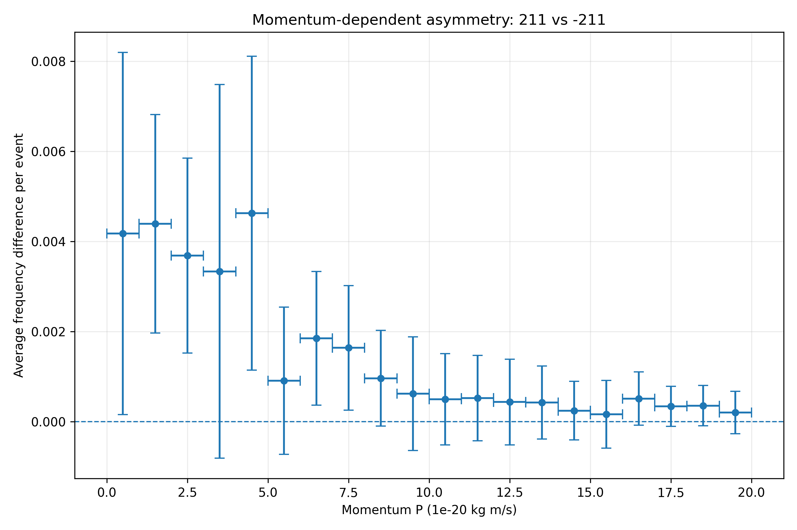
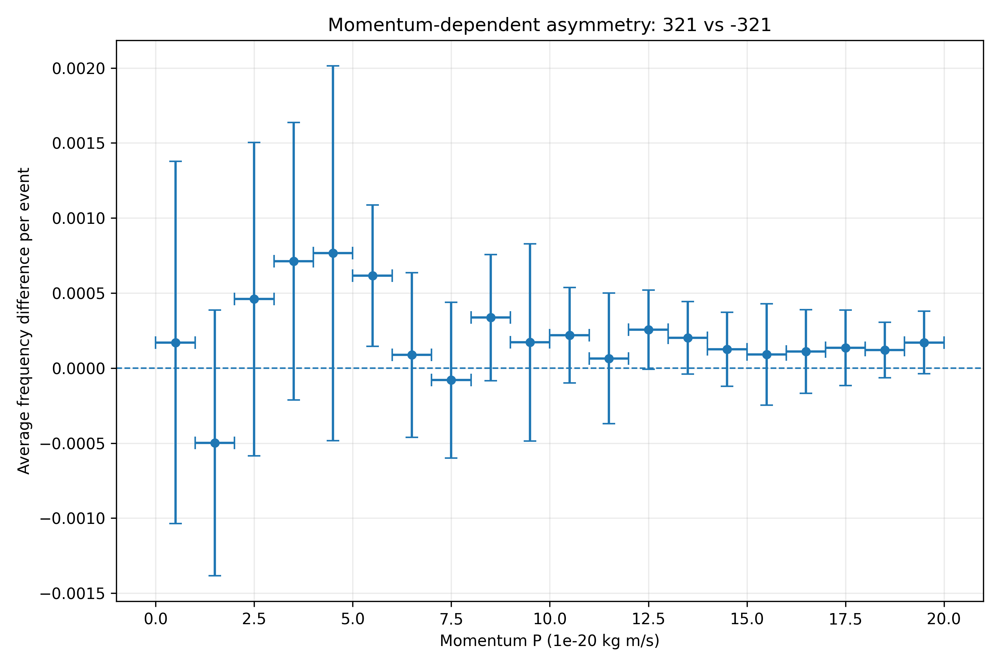
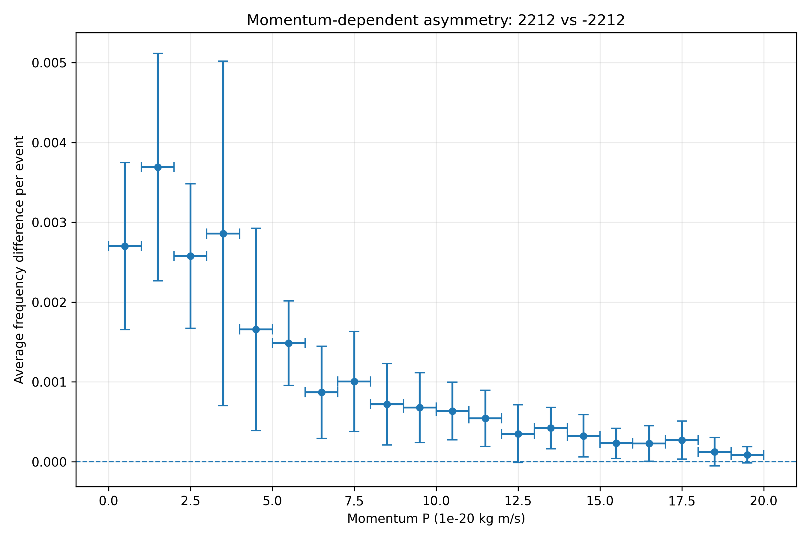
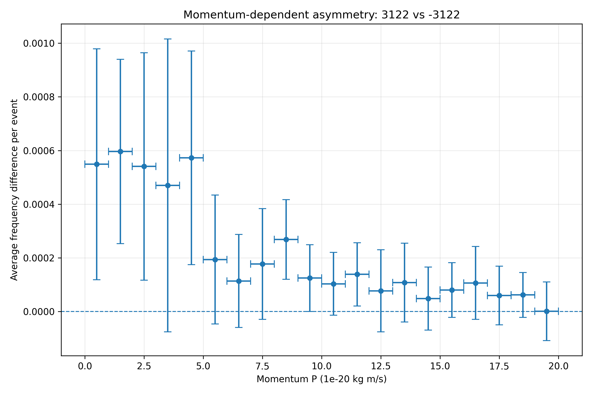
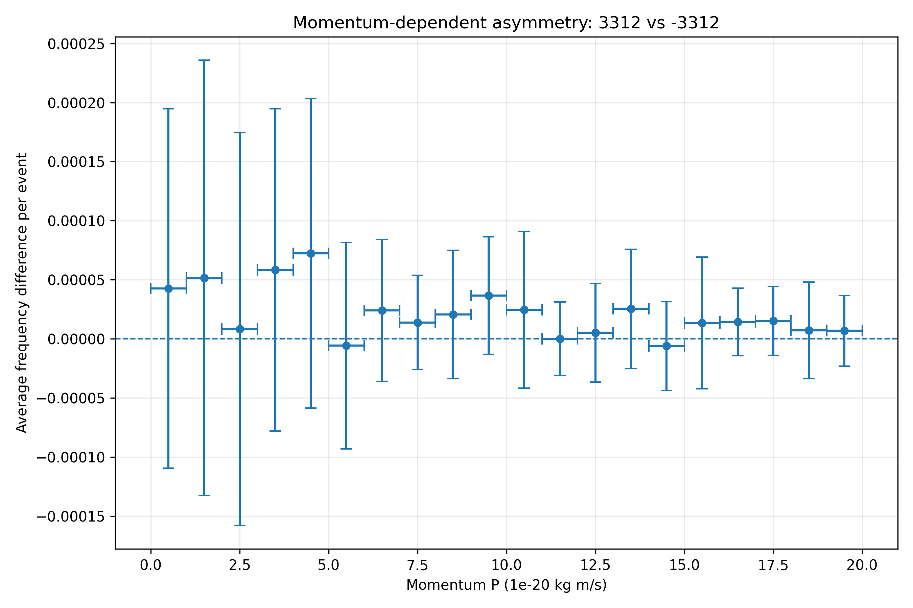
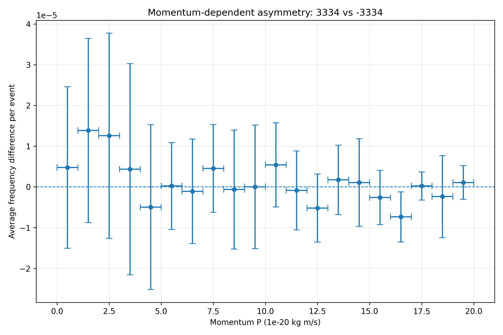

# PRA2003 - Chemistry-Themed Project

**Week 7 deliverable:** Updated README documenting the complete PRA2003 project and the weekly assignments.  
**Student:** Ketu Gugushvili (i6357186)  
**Course:** Programming PRA2003 (MSP)  
**Project theme:** Chemistry

## Project overview

* The project analyses simulations of molecular species produced during combustion at high temperatures using Python.
* The process includes multiple steps: reading molecule records and calculating momentum, determining molecule frequencies and corresponding statistical uncertainties, and finally evaluating differences between molecule and isotope pairs, as well as how these differences vary with momentum.

## Input data and file structure

* Each input file represents repeated simulations of molecular species produced during combustion at high temperatures. 
* The header contains:
  - event ID: ID of the experiment or simulation run
  - number of molecules tracked: Total number of molecules observed in this run 
* Each row after the header gives:
  - 3D momentum components (px, py, pz in 10^(-23)kg m/s)
  - an integer ID representing the molecule or isotope 

```text
<event_id> <number_of_molecules>
<px> <py> <pz> <molecule_id>
<px> <py> <pz> <molecule_id>
...
<next_event_id> <number_of_molecules>
...
```

- `output-Set0.txt` is used by the Week 2 exercise.
- `output-Set1.txt` through `output-Set10.txt` are the ten subsamples used for the later analysis.

### Molecules analysed 
The table below displays molecule types that are going to be analysed and their respective IDs: 

| Molecule ID | Molecule type            |
|-------------|--------------------------|
| 211         | Carbon monoxide          |
| -211        | Carbon-13 monoxide       |
| 321         | Nitric oxide             |
| -321        | Ionised NO               |
| 2212        | Water                    | 
| -2212       | Heavy water (D2O)        |
| 3122        | Methane (CH4)            |
| -3122       | Methyl ion (CH3-)        |
| 3312        | Ethylene (C2H4)          |
| -3312       | Ionised ethylene (C2H3-) |
| 3334        | Ozone (O3)               |
| -3334       | Superoxide anion (O2-)   |

For the subsampling analysis, the average number of molecules per event is calculated using nonempty events only. Events without molecule records are excluded from the event count, following the event-counting method used in the analysis code. Therefore, the reported averages represent frequencies per nonempty event rather than per every generated simulation event.

## Week 1 Deliverables: Research Questions  

Questions to be answered: 
1. **What are the average counts of each molecular species and their statistical uncertainties?**
2. **Is there any asymmetry between the normal and the variant molecule?**
   - Quantify!
4. **Is there any asymmetry as a function of their momentum?**
   - Quantify! 
   - Magnitude of total momentum calculated as: 

$$
p = \sqrt{p_x^2 + p_y^2 + p_z^2}.
$$

## Methods

### Week 2: Data reading and momentum calculation

**File:** `Week_2.py`

The Week 2 code reads a text file, selects molecule IDs and the momentum components, converts strings into numerical values, and calculates the magnitude of momentum:

$$
p = \sqrt{p_x^2 + p_y^2 + p_z^2}.
$$

The results are displayed in a table of the molecule ID and its calculated momentum.

### Week 3: Average molecule frequency and Poisson uncertainty

**File:** `Week_3.py`

The Week 3 code asks the user for an input filename, selects the 12 molecule IDs of interest, counts their occurrences, and calculates the average number of molecules per event and its Poisson statistical uncertainty. 

For molecule ID $m$:

$$
\bar N_m = \frac{N_m}{N_{\mathrm{events}}},
$$

where $N_m$ is the number of occurrences of that molecule and $N_{\mathrm{events}}$ is the number of events analysed.

Assuming Poisson counting statistics, the uncertainty on the average is:

$$
\sigma_{\bar N_m} = \frac{\sqrt{N_m}}{N_{\mathrm{events}}}.
$$

The statistical uncertainty is calculated using the Poisson assumption, where the standard deviation of a count \(N_m\) is approximated by \(\sqrt{N_m}\). Since the reported result is the average number of molecules per event rather than the total count, this uncertainty is divided by the number of analysed events.

For example, if a molecule appears 1,000 times across 100 analysed events, its average frequency is 10 molecules per event, with a Poisson uncertainty of \(\sqrt{1000}/100 \approx 0.316\).

This approach estimates uncertainty from the total molecule count. In the following weeks, subsampling is introduced to estimate uncertainty from the variation between independent subsets of the simulation data.

The results for each of the 12 molecule IDs are displayed in the table. 

### Week 4: Subsampling and overall molecule-pair asymmetry 

**File:** `Week_4(3).py` (also includes the Week 5 analysis)

The Week 4 code calculates the average number of each of the 12 molecule IDs per event. The entire sample of the 10 files is analysed as sub-samples, separately, and assigned statistical uncertainty from the spread of the results.  

The analysis also questions whether there is evidence of an asymmetry between each molecule pair by calculating their mean differences:
- 211 and -211
- 321 and -321
- 2212 and -2212
- 3122 and -3122
- 3312 and -3312
- 3334 and -3334

#### Combining the ten subsamples
 
* For each sub-sample, the code counts the number of molecules associated with each of the 12 IDs and calculates the average number of molecules per event. 
* Then, it combines the results from the subsamples using a weighted average `np.average(values, weights=weights)`:
  
$$
\bar N_m = \frac{\sum_{i=1}^{K} n_i\bar N_{m,i}}{\sum_{i=1}^{K}n_i}, \qquad K=10,
$$

* The events number($n_i$) in each sub-sample($i$) is used as the weight
  - This is done to increase the contribution to the final average  of sub-samples with more events proportionally.
  - In case the number of events is the same in all sub-samples, the weighted average is the same as the standard average. 

#### Statistical uncertainty

* The program uses the sub-sampling method to calculate statistical uncertainty.
* For each sub-sample, the average number of molecules per event is calculated.
* Then, statistical uncertainty is calculated as the **sample standard deviation**, representing the spread of these results with `np.std(values, ddof=1)`:
  
$$
s_m = \sqrt{\frac{1}{K-1}\sum_{i=1}^{K}\left(\bar N_{m,i}-\langle\bar N_m\rangle\right)^2}.
$$

where:
* (K=10) is the number of subsamples.
* (\bar N_{m,i}) is the average frequency of molecule (m) in subsample (i).
* (\bar N_{m,\mathrm{unweighted}}) is the arithmetic mean of the ten subsample averages.
* (s_m) is the sample standard deviation of the ten average frequencies.

In Python, the uncertainty is calculated using np.std(values, ddof=1). The parameter ddof=1 applies the sample standard deviation formula, dividing the sum of squared deviations by (K-1) rather than (K).

The final reported average frequency is event-weighted because subsamples containing more events contribute proportionally more to the combined estimate. However, the uncertainty is calculated from the unweighted spread of the ten subsample averages.

#### Molecule-Pair Asymmetry Analysis

* To determine if a molecule was asymmetric to its ID pair or not, the difference between their averages is calculated for each sample:
  - Since data for each ID comes from the same dataset, it isn't possible to assume no correlation between them
  - The difference that doesn't assume no correlation is expressed as:
    
$$
D_i = \bar N_{+,i}-\bar N_{-,i}.
$$

* The overall difference is the event-weighted mean of these differences.
* Its statistical uncertainty is the sample standard deviation of the ten paired differences:

$$
SD = SD(D_1,D_2,\ldots,D_K).
$$

* To further assess the importance of these differences, the absolute average difference is divided by its statistical uncertainty:
   - `|difference| / uncertainty` (in this file, this ratio will be referenced as significance) 

$$
\sigma =\frac{|\bar D|}{SD}.
$$

* This ratio represents how large the observed difference is compared to the statistical variation between the subsamples. 
* A larger ratio means that the observed difference is large compared with the subsample spread, therefore significant.
   - This ratio was used in this analysis as a descriptive measure to support the asymmetry comparison:
     - $1\sigma$: 1 in 6 chance the result is caused by fluctuations
     - $2\sigma$: 1 in 44 chance
     - $3\sigma$: correspond to a 1-in-740 chance of a statistical quirk
     - $4\sigma$: corresponds to a 1-in-32,000 chance
     - $5\sigma$: is a 1-in-3.5 million chance

### Week 5 Deliverables: Momentum-dependent asymmetry 

**File:** `Week_4.py`

The next question is whether the difference between each molecule and its variant changes with momentum. Instead of calculating only one difference for the complete momentum range, the program calculates a **separate average frequency difference for every momentum bin**.

The configured momentum range is 0–20, divided into 20 equal-width bins. The program calculates each molecule's momentum magnitude and counts molecules directly into the appropriate bin. This avoids storing every individual momentum value and reduces memory usage.

For subsample $i$ and momentum bin $j$, the average frequency per event is:

$$
f_{\pm,i,j}=\frac{N_{\pm,i,j}}{n_i}.
$$

The paired difference for that subsample and bin is:

$$
D_{i,j}=f_{+,i,j}-f_{-,i,j}.
$$

The graph's y-value is the mean paired difference across the ten subsamples:

$$
\bar D_j=\frac{1}{K}\sum_{i=1}^{K}D_{i,j},
$$

and the vertical error bar is the sample standard deviation:

$$
SD=SD(D_{1,j},D_{2,j},\ldots,D_{K,j}).
$$

* For the momentum-dependent analysis, the uncertainty was calculated separately for every momentum bin and every molecule pair.
* First, the momentum range was divided into 20 equal-width bins. For each bin, the average frequency difference between the paired molecules was calculated independently in each of the ten subsamples.
* This produced ten frequency differences for each momentum bin.

* The mean difference plotted on the graph was calculated as the arithmetic mean of these ten differences. The vertical error bar was calculated as their sample standard deviation:

[
s_{D,j}=\sqrt{\frac{1}{K-1}\sum_{i=1}^{K}
(D_{i,j}-\bar D_j)^2}
]

where:
* (D_{i,j}) is the paired frequency difference in subsample (i) and momentum bin (j).
* (\bar D_j) is the arithmetic mean of the ten differences in bin (j).
* (K=10) is the number of subsamples.
* (s_{D,j}) is the sample standard deviation for bin (j).

In Python, this is calculated using np.std(subsample_differences, axis=0, ddof=1), where axis=0 calculates the standard deviation across the ten subsamples independently for each momentum bin.
* The vertical error bars therefore show how much the paired frequency difference varies between subsamples in each bin.
* The horizontal error bars represent half the width of the momentum bins and indicate the momentum interval covered by each point. They do not represent statistical uncertainty in the measured momentum.

**Reading the graphs:**

- **X-axis:** Momentum magnitude, divided into bins.
- **Y-axis:** Average frequency difference per event between the two molecules in each momentum bin.
- **Positive y-value:** The positive-ID molecule occurs more frequently in that bin, on average per event.
- **Negative y-value:** The negative-ID molecule occurs more frequently.
- **Zero:** Equal average frequencies for the pair in that bin.
- **Vertical error bars:** Subsample standard deviation of the paired differences.
- **Horizontal error bars:** Half the momentum-bin width, showing the bin interval rather than measurement uncertainty in momentum.

The momentum-bin mean is currently equally weighted across subsamples, while the overall Week 4 mean is event-weighted. The two are directly comparable when the subsamples have equal event counts; otherwise, this difference in weighting should be considered.

The script is designed to generate one plot per pair, named `momentum_asymmetry_<positiveID>_<negativeID>.png`.

## Results and interpretation

### Week 4: Average Number of Molecules per Event

The results obtained from the complete sample are:

| Molecule ID | Average per event | Statistical uncertainty |
|---:|---:|---:|
| 211 | 19.94950794 | 0.03274619 |
| -211 | 19.91721122 | 0.03187334 |
| 321 | 2.50914781 | 0.00477369 |
| -321 | 2.50345680 | 0.00550369 |
| 2212 | 1.20803410 | 0.00189633 |
| -2212 | 1.18416095 | 0.00241216 |
| 3122 | 0.27659851 | 0.00107440 |
| -3122 | 0.27169595 | 0.00098538 |
| 3312 | 0.03944116 | 0.00028368 |
| -3312 | 0.03900049 | 0.00040248 |
| 3334 | 0.00118710 | 0.00004168 |
| -3334 | 0.00115158 | 0.00005079 |

| Molecule pair | Average difference per event | Statistical Uncertainty | Significance | Asymmetry |
|---|---:|---:|---:|---:|
| 211 vs -211 | 0.03229671 | 0.00451870 | 7.15 | Yes |
| 321 vs -321 | 0.00569100 | 0.00329367 | 1.73 | No |
| 2212 vs -2212 | 0.02387314 | 0.00237277 | 10.06 | Yes |
| 3122 vs -3122 | 0.00490256 | 0.00058316 | 8.41 | Yes |
| 3312 vs -3312 | 0.00044067 | 0.00048793 | 0.90 | No |
| 3334 vs -3334 | 0.00003551 | 0.00006854 | 0.52 | No |


#### Interpretation of the Molecule Pairs

##### 211 vs -211

The average difference is: `0.03229671 ± 0.00451870`

* The difference is approximately 7.15 times the statistical uncertainty.
  - Thus, the observed difference is significant due to how large it is relative to the statistical variation between the sub-samples.
  - The results provide evidence of an asymmetry between 211 and -211.

##### 321 vs -321

The average difference is: `0.00569100 ± 0.00329367`

* The difference is approximately 1.73 times the statistical uncertainty.
  - Thus, the difference is not significantly large compared with the statistical variation between the sub-samples.
  - The evidence doesn't support an asymmetry between 321 and -321 completely.

##### 2212 vs -2212

The average difference is: `0.02387314 ± 0.00237277`

* The difference is approximately 10.06 times the statistical uncertainty.
  - The observed difference is much larger than the statistical variation.
  - The results provide evidence of an asymmetry between 2212 and -2212.

##### 3122 vs -3122

The average difference is: `0.00490256 ± 0.00058316`

* The difference is approximately 8.41 times the statistical uncertainty.
  - The difference is significantly large compared with the statistical variation.
  - The results provide evidence of an asymmetry between 3122 and -3122.

##### 3312 vs -3312

The average difference is: `0.00044067 ± 0.00048793`

* The difference is approximately 0.90 times the statistical uncertainty.
  - The difference is way too small relative to the statistical variation.
  - There is no evidence of an asymmetry between 3312 and -3312.

##### 3334 vs -3334

The average difference is: `0.00003551 ± 0.00006854`

* The difference is approximately 0.52 times the statistical uncertainty.
  - The difference is smaller than its uncertainty.
  - There is no evidence of an asymmetry between 3334 and -3334.


### Week 5: Momentum-Dependent Asymmetry

#### 211 vs -211: Carbon monoxide and Carbon-13 monoxide



#### 321 vs -321: Nitric Oxide and ionised NO



#### 2212 vs -2212: Water and heavy water 



#### 3122 vs -3122: Methane and methyl ion



#### 3312 vs -3312: Ethylene and ionised ethylene



#### 3334 vs -3334: Ozone  and superoxide anion 



#### Overall comparison and interpretation of momentum-dependent asymmetry 

| Molecule pair | Pattern visible in momentum plot | Interpretation |
|---|---|---|
| 211 vs -211 | Positive difference, largest at low momentum, decreasing with momentum | Clear descriptive low-momentum concentration |
| 321 vs -321 | Small differences, variable sign at low momentum; uncertainties often span zero | No clear consistent momentum trend |
| 2212 vs -2212 | Positive difference that generally decreases with momentum | Clear descriptive low-momentum concentration |
| 3122 vs -3122 | Mostly positive, larger at low momentum, but substantial spread | Suggestive decreasing pattern with considerable uncertainty |
| 3312 vs -3312 | Very small differences, mostly consistent with zero within plotted spread | No clear momentum-dependent asymmetry |
| 3334 vs -3334 | Tiny differences of mixed sign with large relative spread | No clear momentum-dependent asymmetry |


## Repository structure


PRA2003-project/
├── README.md
├── Week_2_Momentum.py
├── Week_3_Molecule_Frequencies.py
├── Week_4_5_Complete_Analysis.py
│
├── Plots/
│   ├── momentum_asymmetry_211_-211.png
│   ├── momentum_asymmetry_321_-321.png
│   ├── momentum_asymmetry_2212_-2212.png
│   ├── momentum_asymmetry_3122_-3122.png
│   ├── momentum_asymmetry_3312_-3312.png
│   └── momentum_asymmetry_3334_-3334.png
│
├── csv_results/
│   ├── subsample_results.csv
│   ├── final_molecule_results.csv
│   ├── overall_pair_asymmetry.csv
│   ├── momentum_asymmetry_results.csv
│   ├── momentum_211_-211.csv
│   ├── momentum_321_-321.csv
│   ├── momentum_2212_-2212.csv
│   ├── momentum_3122_-3122.csv
│   ├── momentum_3312_-3312.csv
│   └── momentum_3334_-3334.csv
│
└── output-Set*.txt


Large course-provided data files may be excluded from the public repository. In that case, obtain them through the course and place them in the working directory before running the scripts.

## Requirements and installation

- Python 3.9 or newer
- [NumPy](https://numpy.org/)
- [Matplotlib](https://matplotlib.org/)
- Python standard-library modules `os` and `math` (no separate installation required)

Clone or download the repository and open a terminal in its folder. Optionally, create and activate a virtual environment:

```bash
python -m venv .venv
```

**macOS / Linux:**

```bash
source .venv/bin/activate
```

**Windows PowerShell:**

```powershell
.venv\Scripts\Activate.ps1
```

Install the external packages:

```bash
python -m pip install numpy matplotlib
```

Place the required `.txt` files alongside the scripts, or adjust the filenames in the code to point to their location.

## How to run the project

Run the scripts from the project directory in the order corresponding to the weekly work.

**Week 2 — Calculate molecule momentum:**

```bash
python "Week_2.py"
```

The script reads `output-Set0.txt` and prints molecule IDs and momentum magnitudes.

**Week 3 — Analyse one file:**

```bash
python "Week_3.py"
```

Enter the input filename when prompted, for example `output-Set1.txt`. The script prints the number of detected events and the average frequency and Poisson uncertainty for each of the twelve molecule IDs.

**Weeks 4–5 — Analyse all ten subsamples and generate plots:**

```bash
python "Week_4.py"
```

This script expects `output-Set1.txt` through `output-Set10.txt`. It prints the per-subsample and combined frequency tables, overall molecule-pair differences, and momentum-dependent bin results, then saves six PNG graphs.

The filenames, momentum range, and number of bins are configured near the top of `Week_4.py` using `FILENAMES`, `MOMENTUM_MIN`, `MOMENTUM_MAX` and `NUMBER_OF_BINS`.

**Status of the uploaded code:** Before relying on the output, correct the event-header parsing in `Week_4.py` and the indentation of the momentum-bin results printing loop. The current Week 3 event counting and Week 2 multi-event parsing also require review. The scripts have not been verified against the complete input dataset in this README.

## Program output

The project produces the following outputs:

1. A Week 2 console table displaying molecule IDs and their momentum magnitudes.
2. A Week 3 table showing average molecule frequencies and Poisson uncertainties for a selected input file.
3. Week 4 tables containing individual subsample frequencies, combined averages, statistical uncertainties and overall molecule-pair differences.
4. Six Week 5 momentum-dependent asymmetry plots, one for each molecule pair.
5. CSV files containing the numerical results of the subsampling and momentum-dependent analyses.

### CSV results

The final Python program automatically exports the numerical analysis results into the `csv_results/` directory.

| File | Contents |
|---|---|
| `subsample_results.csv` | Average frequencies, Poisson uncertainties and event counts for each molecule ID in every subsample |
| `final_molecule_results.csv` | Final weighted average frequencies and subsampling uncertainties |
| `overall_pair_asymmetry.csv` | Average paired differences, uncertainties and difference-to-uncertainty ratios |
| `momentum_asymmetry_results.csv` | Momentum-bin results for all six molecule pairs |
| `momentum_<positiveID>_<negativeID>.csv` | Individual momentum-dependent results for each molecule pair |

The exported CSV files are also included in the GitHub repository, allowing the numerical results to be inspected and compared without rerunning the analysis.

The six generated PNG plots are stored in the `Plots/` directory and displayed in the Week 5 Results section.

## Validation, assumptions and limitations

- The subsampling analysis uses nonempty events only when calculating average molecule frequencies. Events without molecule records are excluded from the denominator.
- Week 3 uses Poisson counting uncertainty, assuming the molecule counts follow Poisson statistics.
- Weeks 4–5 use the sample standard deviation across ten subsamples to quantify statistical variation. This is not equivalent to the standard error of the combined mean.
- Overall molecule-pair differences are calculated within each subsample before combining the results, preserving the paired structure of the data.
- The difference-to-uncertainty ratios are descriptive comparisons and are not interpreted as formal Gaussian significance levels.
- Week 4 uses event-weighted averages, whereas Week 5 uses equally weighted averages across subsamples. This distinction matters if the subsamples contain different numbers of events.
- Molecules outside the selected momentum range are excluded from the momentum-dependent analysis.
- The momentum units and bin settings should be consistent with the original simulation dataset.
- The numerical results and plots can be inspected using the CSV and PNG files included in the repository.

## Reproducibility and future improvements

The project includes Python scripts, numerical CSV outputs and momentum-dependent asymmetry plots to support reproducibility.

To reproduce the analysis, the same input datasets, molecule IDs, event-counting method and momentum-bin settings should be used. The exported CSV files allow the individual subsample results and final calculated values to be checked independently.

Possible future improvements include implementing automated tests for data parsing and statistical calculations, introducing configurable input and output directories, and extending the analysis to additional molecule species or momentum ranges.

## References

- PRA2003 programming course materials and supplied chemistry-themed simulation dataset.
- [Python documentation](https://docs.python.org/3/)
- [NumPy documentation](https://numpy.org/doc/)
- [Matplotlib documentation](https://matplotlib.org/stable/)


